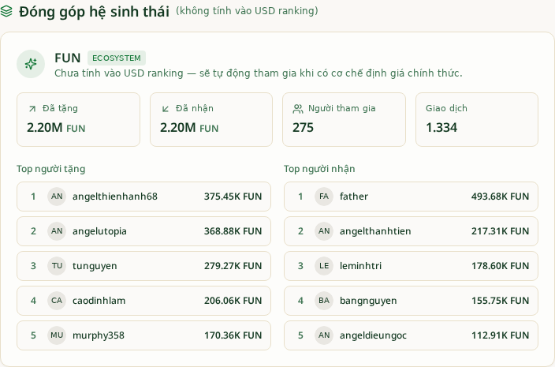

# Benefactors v2 — Bước 1 Report
**Generic Contribution Dimensions Foundation**
Ngày: 2026-07-02 · Trạng thái: **PASS**

> **Note về số FUN (bổ sung sau review Cha):** Estimate cũ 32.45B sent / 18.63B received là **sai** — nhiều khả năng đọc thẳng cột `amount` ở đơn vị wei (18 decimals) mà không chia `10^decimals`, đồng thời gộp cả ví ngoài + failed/pending. Số đúng theo SSOT `donations`:
> - Tổng FUN mọi trạng thái: **26.52M FUN** (1,559 dòng)
> - Ví ngoài / sender NULL: **24.32M FUN** (91.7%, bị loại đúng theo policy `external-wallet-no-gift`)
> - Eligible user↔user (confirmed/null, `is_external=false`, `sender_id<>recipient_id`): **2.20M FUN** (1,335 dòng) — số panel đang hiển thị.
>
> Không có FUN nào "bị mất" do filter mới; số 2.20M là giá trị đóng góp user↔user thật.

## 1. Phạm vi đã triển khai

- Thêm cột `tokens_registry.ranking_dimension` (`usd` / `ecosystem` / `none`) + `token_icon` (nullable, chưa seed).
- Seed hiện trạng: `usd` = BTC/BTCB/BNB/USDT/CAMLY; `ecosystem` = FUN; `none` = tBNB/TONCOIN/CAMLY@97.
- 2 RPC generic mới:
  - `get_token_leaderboard(token, direction, time, limit, offset, from, to)` — raise `invalid_direction` nếu direction không phải `sent|received`, join metadata (`token_symbol/token_icon/token_decimals/ranking_dimension`).
  - `get_contribution_dimension_stats(dimension, time, from, to)` — raise `invalid_dimension` nếu không thuộc `usd|ecosystem|none`; đọc token động từ registry, KHÔNG hardcode 'FUN'.
- 2 hook mới `useTokenLeaderboard` + `useContributionDimensionStats` trong file **riêng** `src/hooks/useContributionDimensions.ts` (không chạm hook USD cũ).
- Component mới `src/components/benefactors/ContributionDimensionsPanel.tsx` — render theo `data.map(dim => ...)`, hoàn toàn generic.
- `src/pages/Benefactors.tsx`: chỉ +2 dòng (import + render panel sau `</Tabs>`), không đổi gì khác.

**Không đụng:** 3 RPC USD (`get_benefactor_leaderboard`, `get_recipient_leaderboard`, `get_donation_global_stats`), Export CSV, Unified History, scanner, UI ranking cũ.

## 2. SQL Proofs

### P1 — USD rank không đổi
```
 rank |     username     | total_amount_usd
------+------------------+------------------
    1 | father           |       1046470.78
    2 | funtreasury      |         97023.71
    3 | angelutopia      |         86632.62
    4 | angelkim         |         79262.18
    5 | angelthienhanh68 |         71229.30
```
✅ father #1, funtreasury #2 giữ nguyên.

### P2 — FUN KHÔNG xuất hiện trong `totals_by_token` của USD rank
```sql
SELECT COUNT(*) FROM get_benefactor_leaderboard(50,0,'all',NULL) WHERE totals_by_token ? 'FUN';
-- 0
```

### P3 — Ecosystem dimension stats (registry-driven, không hardcode FUN)
```
 token_symbol | total_sent | transactions | unique_participants | unique_senders | unique_recipients
--------------+------------+--------------+---------------------+----------------+-------------------
 FUN          | 2202141.78 |         1334 |                 275 |             70 |               264
```

### P4 — Top FUN senders (metadata joined)
```
 rank |     username     | total_amount | token_symbol | token_decimals
------+------------------+--------------+--------------+----------------
    1 | angelthienhanh68 |       375452 | FUN          |             18
    2 | angelutopia      |       368881 | FUN          |             18
    3 | tunguyen         |       279274 | FUN          |             18
```

### P5 — BTC token leaderboard regression pass
```
 rank |  username   | total_amount | total_amount_usd
------+-------------+--------------+------------------
    1 | father      |  10.30495000 |       1030495.00
    2 | angelutopia |   1.11856498 |         85728.11
    3 | angelkim    |   1.01846548 |         68175.76
```

### P6 — Invalid direction raise rõ ràng
```
NOTICE:  OK: invalid_direction: p_direction must be sent or received, got bogus
```

### P7 — Registry seed
```
 ranking_dimension |              symbols
-------------------+---------------------------------------
 ecosystem         | FUN@97
 none              | CAMLY@97,tBNB@97,TONCOIN@56
 usd               | BNB@56,BTC@0,BTCB@56,CAMLY@56,USDT@56
```

## 3. Architecture Validation — hai module độc lập cùng đọc SSOT

**a. `ContributionDimensionsPanel` KHÔNG import USD leaderboard hooks:**
```
$ grep -E "useBenefactorLeaderboard|useRecipientLeaderboard|get_benefactor_leaderboard|get_recipient_leaderboard" \
    src/components/benefactors/ContributionDimensionsPanel.tsx \
    src/hooks/useContributionDimensions.ts
# only match: 1 comment line trong useContributionDimensions.ts giải thích chủ ý.
# 0 import statement thực sự.
```

**b. `ContributionDimensionsPanel` KHÔNG chứa literal 'FUN':**
```
$ grep -n "FUN" src/components/benefactors/ContributionDimensionsPanel.tsx src/hooks/useContributionDimensions.ts
# no match
```

**c. `useBenefactorLeaderboard` (USD) KHÔNG biết Contribution tồn tại:**
```
$ grep -E "ContributionDimensions|useContributionDimensionStats|useTokenLeaderboard|get_contribution_dimension_stats|get_token_leaderboard" \
    src/hooks/useBenefactorLeaderboard.ts
# no match
```

**d. Sơ đồ độc lập:**
```
┌────────────────────────────┐     ┌──────────────────────────────────┐
│  USD Ranking Module        │     │  Contribution Dimensions Module  │
│  ────────────────────      │     │  ─────────────────────────       │
│  useBenefactorLeaderboard  │     │  useContributionDimensionStats   │
│  useRecipientLeaderboard   │     │  useTokenLeaderboard             │
│  get_benefactor_...        │     │  get_contribution_dimension_...  │
│  get_recipient_...         │     │  get_token_leaderboard           │
│  get_donation_global_...   │     │                                  │
└────────────┬───────────────┘     └────────────┬─────────────────────┘
             │                                  │
             └──────────┬───────────────────────┘
                        ▼
         SSOT: donations + tokens_registry
                (ranking_dimension driver)
```

Mai thêm NFT/Badges/Reputation → chỉ cần `INSERT INTO tokens_registry (..., ranking_dimension='ecosystem')` và panel tự hiện thêm 1 card, KHÔNG sửa code.

## 4. UI Evidence

Panel render trên `/benefactors` (dưới bảng USD ranking):


- Header: "Đóng góp hệ sinh thái (không tính vào USD ranking)"
- Card: `FUN [ECOSYSTEM]` — 2.20M sent / 2.20M received / 275 participants / 1,334 giao dịch
- Top người tặng: angelthienhanh68 375.45K FUN, angelutopia 368.88K FUN, ...
- Top người nhận: father 493.68K FUN, angelthanhtien 217.31K FUN, ...

## 5. Toolchain

- `bunx tsgo --noEmit`: **PASS** (0 error).
- `bun run build`: **PASS** (53.53s).

## 6. Rollback (an toàn)

```sql
DROP FUNCTION IF EXISTS public.get_token_leaderboard(text,text,text,integer,integer,timestamptz,timestamptz);
DROP FUNCTION IF EXISTS public.get_contribution_dimension_stats(text,text,timestamptz,timestamptz);
ALTER TABLE public.tokens_registry DROP CONSTRAINT IF EXISTS tokens_registry_ranking_dimension_check;
ALTER TABLE public.tokens_registry DROP COLUMN IF EXISTS ranking_dimension;
ALTER TABLE public.tokens_registry DROP COLUMN IF EXISTS token_icon;
```
UI: revert 2 dòng trong `Benefactors.tsx` + xóa `ContributionDimensionsPanel.tsx` + `useContributionDimensions.ts`. **0 data mutation.**

## 7. Bước 2 (chờ duyệt)

- Redesign UI đầy đủ theo mockup Cha (Hero + 4 KPI cards + Token Overview + segmented 3 tabs + Progress bar).
- Cột FUN summary trong Top USD table.
- Export CSV mở rộng thêm `fun_sent_amount` / `fun_received_amount`.
- Không đụng RPC USD.
