# Báo cáo Tổng hợp — M6A Statistics Audit

**Ngày**: 2026-07  
**Auditor**: M6A Statistics Audit  
**Phạm vi**: Toàn bộ statistics surface, pricing, ranking, SSOT  
**Trạng thái**: DRAFT — chờ xác nhận DB access

---

## Executive Summary

| Chỉ số | Số lượng | Ghi chú |
|---|---|---|
| **Statistics surfaces** (inventory) | 23 | `statistics_inventory.csv` rows 2–24 |
| **Duplicate groups** (DUP-01 → DUP-09) | 9 | `statistics_duplicate_groups.csv` |
| **USD pricing sources** | 9 | `usd_pricing_sources.csv` rows 2–10 |
| **Ranking implementations** | 13 | `ranking_implementations.csv` rows 2–14 |
| **SSOT matrix surfaces** | 20 | `statistics_ssot_matrix.csv` rows 2–21 |
| **Surfaces đạt ✅ đầy đủ** | ~4 | Benefactors, Recipient LB, Founder Overview, Honor Board |
| **Surfaces có ⚠ ít nhất 1 cột** | ~11 | Cần refactor |
| **Surfaces chưa xác nhận (❌)** | ~5 | Treasury, Export PDF, Notification, Feed widget, … |
| **Gap kiến trúc nghiêm trọng (P0/P1)** | 4 | TD-05, Swap G1, Swap G3, USD multi-source |

### Tóm tắt rủi ro

> **Hệ thống hiện tại không có SSOT (Single Source of Truth) cho statistics.** Cùng một chỉ số được tính bởi nhiều nơi khác nhau (FE hook, RPC, client `.reduce()`) với input source khác nhau, dẫn đến nguy cơ **số liệu không nhất quán** giữa các màn hình.  
> Đồng thời, **bảng `transactions`** (BTC/USDT/BNB reconciliation + CAMLY claim) có thể bị **bỏ sót hoàn toàn** trong lịch sử giao dịch hợp nhất — xem TD-05 Verdict.  
> **Swap** chỉ có 1 producer duy nhất là FE client trực tiếp INSERT — nếu FE crash sau khi on-chain transaction thành công, record bị mất.

---

## Phần 1 — Inventory (Statistics Surfaces)

> Source: `evidence/statistics_inventory.csv`

Kiểm kê 23 surfaces thống kê trong hệ thống, phân loại theo loại tính toán:

| Loại tính toán | Surfaces đại diện |
|---|---|
| **SUM + COUNT** (tổng hợp token) | `usePublicDonationHistory` (dòng 2), `useGiftBreakdown` (dòng 4) |
| **DIRECTION** (phân loại in/out) | `usePublicDonationHistory:365` (dòng 3) |
| **FORMAT** (hiển thị số) | `GlobalGiftStatsModal:50–65` (dòng 5) |
| **RPC call** (server tính sẵn) | `WalletCenterContainer get_my_rewards` (dòng 9), `Benefactors get_donation_global_stats` (dòng 11) |
| **RANK** (xếp hạng) | `Benefactors:29` benefactor rank (dòng 12), recipient rank (dòng 13) |
| **RPC + client reduce** | `FounderEconomyPanel` (dòng 18), `ContentStatsModal` (dòng 20) |
| **SELECT trực tiếp + reduce** | `FounderPPLPAnalyticsPanel:19–51` (dòng 19) |

**Vấn đề chính**: 6/23 surfaces dùng client-side `SELECT + .reduce()` thay vì RPC — vi phạm nguyên tắc SSOT và gây trùng lặp logic.

**Surfaces dùng RPC đúng cách (tốt)**: `WalletCenterContainer get_my_rewards`, `Benefactors get_benefactor_leaderboard`, `Leaderboard get_light_community`, `FounderOverviewPanel get_founder_overview_stats`.

---

## Phần 2 — USD Pricing (Đa nguồn giá)

> Source: `evidence/usd_pricing_sources.csv`

Hệ thống hiện dùng **9 nguồn/cơ chế giá USD** khác nhau:

| # | Nguồn | File:Line | Phương pháp | Surfaces dùng |
|---|---|---|---|---|
| 1 | `useTokenPrices` hook (primary) | `src/hooks/useTokenPrices.ts:1–75` | Market — gọi edge `token-prices` (CoinGecko) | `useGiftBreakdown`, `GlobalGiftStatsModal`, bất kỳ component import |
| 2 | `FALLBACK_PRICES` hardcode | `src/hooks/useTokenPrices.ts:16–25` | BNB=$700 / BTC=$100k / USDT=$1 / CAMLY=$0.000014 / ETH=$3500 / POL=$0.5 / TON=$5 | Tất cả surfaces khi edge lỗi |
| 3 | `token-prices` edge (proxy) | `supabase/functions/token-prices/index.ts` | Market — external API (CoinGecko) | `useTokenPrices` |
| 4 | `token_price_history` table | Chưa xác định FE consumer | History — lưu giá theo thời điểm | Chưa rõ |
| 5 | `get_benefactor_leaderboard` RPC | supabase/migrations (SQL chưa đọc được) | Server-side JOIN `token_price_history` hoặc hardcode | `useBenefactorLeaderboard` → `BenefactorsPage`, `ExportCsvDialog` |
| 6 | `get_recipient_leaderboard` RPC | supabase/migrations | Server-side tự tính USD | `useRecipientLeaderboard` → `BenefactorsPage`, `ExportCsvDialog` |
| 7 | `get_donation_global_stats` RPC | supabase/migrations | Server-side tự tính USD | `BenefactorsPage:52–64`, `ExportCsvDialog` |
| 8 | `GlobalGiftStatsModal priceMap` | `src/components/feed/GlobalGiftStatsModal.tsx:78–90` | Client-side override BTC→BTCB / BNB→WBNB | `GlobalGiftStatsModal` |
| 9 | `useGiftBreakdown usd_value` | `src/hooks/useGiftBreakdown.ts:~85–100` | Client-side `useTokenPrices × amount` | `GiftBreakdownDialog`, Profile stats |

### Rủi ro đa nguồn giá

- **Inconsistency**: `GlobalGiftStatsModal` override `BTC→BTCB / BNB→WBNB` (`GlobalGiftStatsModal.tsx:78–90`) — giá hiển thị khác với RPC leaderboard dùng `token_price_history`.
- **FALLBACK hardcode**: BTC=$100,000 / BNB=$700 — khi CoinGecko lỗi, toàn bộ USD value tính từ hardcode stale, có thể sai ±50% trong thị trường biến động.
- **Client vs Server mismatch**: `useGiftBreakdown` tính USD client-side từ `useTokenPrices`, trong khi `get_benefactor_leaderboard` tính server-side từ `token_price_history` — cùng một khoản donate hiển thị 2 giá trị USD khác nhau tùy màn hình.
- **Phương pháp RPC chưa rõ**: SQL của `get_benefactor_leaderboard`, `get_recipient_leaderboard`, `get_donation_global_stats` không đọc được từ migration — không thể xác nhận họ dùng `token_price_history` hay hardcode.

---

## Phần 3 — Ranking (Xếp hạng)

> Source: `evidence/ranking_implementations.csv`

Hệ thống có **13 ranking implementations** cho 8 loại bảng xếp hạng:

| Ranking | File/RPC | Sort Key | Scope | Consumers | Note |
|---|---|---|---|---|---|
| **Benefactor Leaderboard** | `get_benefactor_leaderboard` | `total_donated_usd DESC` | day/week/month/all | `Benefactors.tsx:29`, `ExportCsvDialog.tsx:109–115` | SSOT tốt |
| **Recipient Leaderboard** | `get_recipient_leaderboard` | `total_received_usd DESC` | day/week/month/all | `Benefactors.tsx:34`, `ExportCsvDialog.tsx:109–115` | SSOT tốt |
| **Light Community** | `get_light_community` | level hierarchy + `light_score DESC` | all-time | `Leaderboard.tsx:92` | SSOT tốt |
| **Top Ranking (Feed)** | `get_light_community` | same | all-time | `TopRanking.tsx:43` | DUP-07 — same RPC nhưng 2 query key khác nhau |
| **Pet Leaderboard** | `pet_leaderboard_top` | `pet_level + cheers_7d DESC` | 7-day rolling | `Leaderboard.tsx` pet tab | Tách biệt — OK |
| **Honor Board** | `get_user_honor_stats` | per-user (không cross-user rank) | all-time per user | `CoverHonorBoard.tsx` (2 lần!), `WalletCenterContainer.tsx:341` | Gọi RPC 2 lần trong cùng component |
| **Founder PPLP** | SELECT `pplp_v2_validations` + client `.reduce()` | `avg pillar score DESC` client-side | all-time (last 1000 rows) | `FounderPPLPAnalyticsPanel.tsx:19–51` | DUP-08 — cần RPC `get_founder_pplp_stats` |
| **Founder Economy** | `get_founder_economy_stats` + client `.reduce()` | date ASC + `.slice(-days)` | 30/60/90/365 day | `FounderEconomyPanel.tsx:17–36` | DUP-08 — client slice cần push vào SQL |

**Issues**:
- **DUP-07**: `Leaderboard.tsx` và `TopRanking.tsx` gọi cùng `get_light_community` RPC nhưng không share React Query key → 2 network requests giống hệt nhau.
- **DUP-08**: `FounderPPLPAnalyticsPanel` SELECT trực tiếp bảng `pplp_v2_validations` + client `.reduce()` — cần tạo RPC `get_founder_pplp_stats`.
- **Honor Board**: `CoverHonorBoard.tsx` gọi `get_user_honor_stats` **2 lần** trong cùng component — cần unify queryKey.

---

## Phần 4 — Duplicate Groups (DUP-01 → DUP-09)

> Source: `evidence/statistics_duplicate_groups.csv`

| ID | Tên nhóm | Loại | Implementations | SSOT đề xuất | Effort |
|---|---|---|---|---|---|
| **DUP-01** | Token SUM by date/breakdown | SUM+GROUP BY token_symbol | `usePublicDonationHistory.ts:60–125` (3 SELECT); `useGiftBreakdown.ts:35–90` (3 SELECT); `useGiftHistory.ts:27–43` (RPC) | RPC `get_gift_day_token_totals` hoặc materialized view `v_token_daily_totals` | Medium |
| **DUP-02** | Direction detection (in/out) | DIRECTION filter | `usePublicDonationHistory.ts:365` (client `sender_id vs userId`); `useUnifiedTransactionHistory` (RPC field) | RPC trả `direction` field — FE không tự tính | Low |
| **DUP-03** | Amount format/display | FORMAT | `GlobalGiftStatsModal.tsx:50–65` (`formatAmount`); nhiều component khác | Shared util `formatGiftAmount()` extract vào `lib/` | Low |
| **DUP-04** | Claim reward SUM | SUM filter on `reward_claims` | `WalletCenterContainer.tsx:374` (totalClaims); `WalletCenterContainer.tsx:379` (todayClaims); `BlockchainTab.tsx:76` (totalClaimed); `get_my_rewards` RPC | RPC `get_my_rewards` **đã có** — loại bỏ 3 client `.reduce()` | Low |
| **DUP-05** | Global donation stats | SUM aggregate | `Benefactors.tsx:52–64` (RPC); `ExportCsvDialog.tsx:109–115` (same RPC) | `get_donation_global_stats` RPC đã là SSOT — ✅ OK | None |
| **DUP-06** | Benefactor/Recipient rank | RANK | `Benefactors.tsx:29` (RPC); `Benefactors.tsx:34` (RPC); `ExportCsvDialog` (same) | Hai RPC đã là SSOT — ✅ OK | None |
| **DUP-07** | Light community top list | RANK+FILTER | `Leaderboard.tsx:92` (RPC `p_limit=1000`); `TopRanking.tsx:43` (same RPC) | `get_light_community` RPC đã là SSOT — share React Query key | Low |
| **DUP-08** | Founder economy aggregates | SUM+GROUP | `FounderEconomyPanel.tsx:17–36` (`.reduce()` on daily_flow); `FounderPPLPAnalyticsPanel.tsx:19–51` (SELECT + `.reduce()`) | `get_founder_economy_stats` RPC cho economy; tạo RPC `get_founder_pplp_stats` mới cho PPLP | Medium |
| **DUP-09** | Content stats aggregate | SUM+GROUP | `ContentStatsModal.tsx:44–89` (RPC + `.reduce()`); `ContentStatsDateDetail.tsx:82–113` (RPC + `.reduce()`) | Push `SUM` vào SQL RPC — FE nhận `grandTotal` sẵn | Low |

**Tổng effort ước tính**:
- Low effort (DUP-02, 03, 04, 07, 09): 5 groups × ~0.5 ngày = ~2.5 ngày
- Medium effort (DUP-01, 08): 2 groups × ~2 ngày = ~4 ngày
- None (DUP-05, 06): Đã đúng

---

## Phần 5 — Dependency Graph

> Source: `evidence/statistics_dependency_graph.mmd`

```mermaid
flowchart TD
    subgraph PRODUCER ["📦 Producers (DB Write)"]
        D[donations\nsupabase table]
        WT[wallet_transfers\nsupabase table]
        ST[swap_transactions\nsupabase table]
        TX[transactions\nreconciliation+claim]
        LA[light_actions /\npplp_v2_validations]
        TPH[token_price_history\nsupabase table]
    end

    subgraph AGGREGATOR ["⚙️ Aggregators"]
        RPC1[get_unified_transactions\nget_unified_summary RPC]
        RPC2[get_benefactor_leaderboard\nget_recipient_leaderboard RPC]
        RPC3[get_donation_global_stats RPC]
        RPC4[get_light_community RPC]
        RPC5[get_founder_overview_stats\nget_founder_economy_stats RPC]
        RPC6[get_user_honor_stats\nget_my_rewards RPC]
        RPC7[pet_leaderboard_top RPC]
        HOOK1[usePublicDonationHistory\nclient-side 3×SELECT+SUM]
        HOOK2[useGiftBreakdown\nclient-side 3×SELECT+SUM]
        CRON[statistics-cron\nedge — nếu có]
        TP[useTokenPrices\ntoken-prices edge proxy]
    end

    subgraph CONSUMER ["🖥️ Consumers (UI)"]
        C1[WalletHistory\nTransactionHistoryPage]
        C2[ProfileHistory\nDonationsPage]
        C3[Benefactors\nRecipient Leaderboard]
        C4[Honor Board\nWalletCenter]
        C5[Founder Dashboard]
        C6[Admin Dashboard\nBlockchainTab]
        C7[Treasury Public\nTreasury Admin]
        C8[Analytics\nContentStats]
        C9[Export Excel\nExport PDF]
        C10[Notification\nFeed Stats]
        C11[Leaderboard\nTopRanking\nPet Leaderboard]
    end

    D --> RPC1
    WT --> RPC1
    ST --> RPC1
    TX -.->|⚠️ gap unconfirmed| RPC1
    D --> RPC2
    WT --> RPC2
    ST --> RPC2
    D --> RPC3
    LA --> RPC4
    LA --> RPC5
    D --> RPC5
    D --> RPC6
    TPH --> RPC2
    TPH --> RPC3

    D --> HOOK1
    WT --> HOOK1
    ST --> HOOK1
    D --> HOOK2
    WT --> HOOK2
    ST --> HOOK2

    TPH --> TP

    RPC1 --> C1
    RPC1 --> C2
    RPC1 --> C9
    RPC2 --> C3
    RPC2 --> C9
    RPC3 --> C3
    RPC4 --> C11
    RPC5 --> C5
    RPC6 --> C4
    RPC7 --> C11
    HOOK1 --> C2
    HOOK2 --> C2
    TP --> C2
    TP --> C3
    CRON -.->|planned| C7
    CRON -.->|planned| C8

    style TX fill:#fecaca
    style HOOK1 fill:#fef9c3
    style HOOK2 fill:#fef9c3
    style CRON fill:#e0e7ff
```



**Nhận xét**:
- `TX` (bảng `transactions`) kết nối đứt gãy (dashed) với `RPC1` — **TD-05 P0**: chưa xác nhận view có bao gồm transactions.
- `HOOK1` và `HOOK2` (màu vàng) bypass RPC layer, trực tiếp SELECT 3 bảng — là nguồn gốc DUP-01.
- `CRON` (màu tím nhạt) chỉ có trong kế hoạch — Treasury/Analytics chưa có data source.

---

## Phần 6 — SSOT Matrix (Điểm từng surface)

> Source: `evidence/statistics_ssot_matrix.csv`  
> Chú thích: ✅ Đạt | ⚠ Cần sửa | ❌ Chưa xác nhận/Thiếu | N/A Không áp dụng

| Surface | Count | Sum | USD | Rank | Primary Source | Điểm tổng | Mức độ |
|---|---|---|---|---|---|---|---|
| WalletHistory (TransactionHistoryPage) | ✅ | ✅ | ⚠ | N/A | `get_unified_transactions` RPC | **B** | USD fallback hardcode |
| ProfileHistory (DonationsPage) | ⚠ | ⚠ | ⚠ | N/A | `usePublicDonationHistory` hook (3×SELECT) | **D** | DUP-01, bỏ sót `transactions` |
| TransactionHistoryPage (admin) | ✅ | ✅ | ⚠ | N/A | `get_unified_transactions` RPC | **B** | USD vẫn từ client token price |
| DonationsPage (user public) | ⚠ | ⚠ | ⚠ | N/A | `usePublicDonationHistory + useGiftBreakdown` | **D** | DUP-01/02 — 2 hooks cùng data |
| RecentTransactions (Feed widget) | ⚠ | N/A | N/A | N/A | SELECT donations trực tiếp (chưa xác nhận) | **C** | Cần thêm evidence |
| WalletCenter (WalletCenterContainer) | ⚠ | ⚠ | N/A | N/A | `get_my_rewards` RPC + client `.reduce()` DUP-04 | **C** | Claim total tính 2 lần |
| Benefactors (Donor leaderboard) | ✅ | ✅ | ⚠ | ✅ | `get_benefactor_leaderboard` RPC | **A** | SSOT tốt nhất hiện tại |
| Recipient Leaderboard | ✅ | ✅ | ⚠ | ✅ | `get_recipient_leaderboard` RPC | **A** | USD method chưa rõ |
| Honor Board (CoverHonorBoard) | ✅ | N/A | N/A | N/A | `get_user_honor_stats` RPC | **A** | Gọi RPC 2 lần — nên share key |
| Founder Dashboard (Overview) | ✅ | ✅ | N/A | N/A | `get_founder_overview_stats` RPC | **A** | Tốt |
| Founder Dashboard (Economy) | ⚠ | ⚠ | N/A | N/A | `get_founder_economy_stats` + `.reduce()` | **C** | daily_flow slice client-side |
| Founder Dashboard (PPLP) | ⚠ | ⚠ | N/A | ⚠ | SELECT `pplp_v2_validations` + `.reduce()` | **D** | Direct table SELECT |
| Admin Dashboard (BlockchainTab) | ⚠ | ⚠ | N/A | N/A | SELECT `reward_claims` + `.reduce()` DUP-04 | **C** | Cùng logic WalletCenter |
| Treasury Public | ❌ | ❌ | ❌ | N/A | Chưa xác nhận | **F** | Cần thêm evidence M6D |
| Treasury Admin | ❌ | ❌ | ❌ | N/A | Chưa xác nhận | **F** | Cần thêm evidence M6D |
| Analytics (ContentStats) | ⚠ | ⚠ | N/A | N/A | `get_content_stats_grouped_vn` + `.reduce()` | **C** | grandTotal client-side |
| Export Excel | ⚠ | ⚠ | ⚠ | N/A | `UnifiedTransactionRow[]` client SUM | **C** | OK nếu data đầy đủ |
| Export PDF | ❌ | ❌ | ❌ | N/A | Chưa xác nhận | **F** | Cần thêm evidence |
| Notification aggregates | ❌ | ❌ | ❌ | N/A | Chưa xác nhận | **F** | Cần thêm evidence M6D |
| Feed stats (GlobalGiftStatsModal) | ⚠ | ✅ | ⚠ | N/A | RPC + `useTokenPrices` client | **B** | priceMap override BTC→BTCB/BNB→WBNB |

**Phân phối điểm**:

| Hạng | Số surfaces | Surfaces |
|---|---|---|
| **A** (Đạt) | 4 | Benefactors, Recipient LB, Honor Board, Founder Overview |
| **B** (Khá) | 3 | WalletHistory, TransactionHistoryPage admin, Feed GlobalGiftStats |
| **C** (Trung bình) | 5 | RecentTransactions, WalletCenter, Founder Economy, BlockchainTab, Analytics, Export Excel |
| **D** (Yếu) | 3 | ProfileHistory, DonationsPage public, Founder PPLP |
| **F** (Chưa xác nhận) | 4 | Treasury Public, Treasury Admin, Export PDF, Notification |

---

## Phần 7 — Kiến trúc SSOT đề xuất

### 7.1 View `v_unified_statistics`

**Mục tiêu**: Tạo một view PostgreSQL làm điểm tổng hợp duy nhất cho tất cả statistics, thay thế client-side `3×SELECT+SUM`.

```sql
-- v_unified_statistics: UNION 4 nguồn
CREATE OR REPLACE VIEW v_unified_statistics AS
  SELECT 'donation'       AS source_type, user_id, recipient_id, token_symbol, amount, created_at, NULL AS tx_hash FROM donations
  UNION ALL
  SELECT 'wallet_transfer' AS source_type, sender_id, recipient_id, token_symbol, amount, created_at, NULL FROM wallet_transfers
  UNION ALL
  SELECT 'swap'           AS source_type, user_id, NULL, from_token, from_amount, created_at, tx_hash FROM swap_transactions
  UNION ALL
  SELECT category         AS source_type, user_id, NULL, token_symbol, amount, created_at, tx_hash
    FROM transactions
    WHERE category IN ('reconciliation_btc','reconciliation_bep20_usdt','reconciliation_bnb','claim_reward');
  -- ⚠️ TD-05: UNION nhánh thứ 4 giải quyết gap bảng transactions
```

### 7.2 RPC `get_unified_benefactor`

| Item | Chi tiết |
|---|---|
| **Input** | `p_user_id UUID`, `p_time_range TEXT` (day/week/month/all) |
| **Output** | `{ total_donated_usd, total_received_usd, total_donations, rank_donor, rank_recipient, token_breakdown: [{token_symbol, amount, usd_value}] }` |
| **Nguồn dữ liệu** | `v_unified_statistics` JOIN `token_price_history` (server-side USD) |
| **Consumers** | `BenefactorsPage.tsx`, `ExportCsvDialog.tsx`, `useBenefactorLeaderboard` |
| **Thay thế** | `get_benefactor_leaderboard` + `get_recipient_leaderboard` + `get_donation_global_stats` (3 RPC → 1 RPC) |
| **Priority** | P1 |

### 7.3 RPC `get_unified_dashboard`

| Item | Chi tiết |
|---|---|
| **Input** | `p_user_id UUID` |
| **Output** | `{ wallet_summary: {total_claimed, today_claimed, camly_balance}, honor_stats: {points, level}, profile_history: [{token_symbol, total_in, total_out, usd_value, direction}] }` |
| **Nguồn dữ liệu** | `v_unified_statistics` + `reward_claims` + `light_actions` |
| **Consumers** | `WalletCenterContainer.tsx`, `CoverHonorBoard.tsx`, `DonationsPage.tsx`, `usePublicDonationHistory` |
| **Thay thế** | `get_my_rewards` + `get_user_honor_stats` + `usePublicDonationHistory` hook (3 nguồn → 1 RPC) |
| **Giải quyết DUP** | DUP-01, DUP-02, DUP-04 |
| **Priority** | P1 |

### 7.4 RPC `get_unified_treasury`

| Item | Chi tiết |
|---|---|
| **Input** | `p_time_range TEXT`, `p_token_symbol TEXT NULL` |
| **Output** | `{ inflow_total_usd, outflow_total_usd, swap_volume_usd, claim_total_camly, net_flow_usd, token_breakdown: [{token_symbol, in, out, net}] }` |
| **Nguồn dữ liệu** | `v_unified_statistics` GROUP BY token_symbol + `token_price_history` |
| **Consumers** | Treasury Public page, Treasury Admin page (❌ hiện chưa xác nhận consumer) |
| **Priority** | P2 — cần evidence M6D trước |

### 7.5 RPC `get_unified_honor`

| Item | Chi tiết |
|---|---|
| **Input** | `p_user_id UUID NULL` (NULL = global leaderboard) |
| **Output** | `{ honor_points, honor_level, rank (nếu global), light_score, pplp_strongest_pillar, pplp_weakest_pillar }` |
| **Nguồn dữ liệu** | `light_actions` + `pplp_v2_validations` + `user_profiles` |
| **Consumers** | `CoverHonorBoard.tsx`, `WalletCenterContainer.tsx`, `Leaderboard.tsx`, `TopRanking.tsx` |
| **Thay thế** | `get_user_honor_stats` + `get_light_community` + `FounderPPLPAnalyticsPanel` SELECT trực tiếp |
| **Giải quyết DUP** | DUP-07, DUP-08 (phần PPLP) |
| **Priority** | P2 |

---

## Phần 8 — M6D Roadmap (Statistics Audit Sâu)

**Mục tiêu**: Hoàn thiện audit, xác nhận các gap còn thiếu evidence, finalize SSOT contracts.

| Task | Mô tả | Priority | Effort |
|---|---|---|---|
| **M6D-01** | DB Admin: Đọc SQL view `v_unified_transactions` — xác nhận có UNION `transactions` không (TD-05) | P0 | 1h |
| **M6D-02** | DB Admin: Đọc SQL `get_benefactor_leaderboard` — xác nhận phương pháp tính USD | P1 | 1h |
| **M6D-03** | Code audit: Tìm Treasury Public/Admin components — xác nhận data source | P1 | 2h |
| **M6D-04** | Code audit: Tìm Export PDF component — xác nhận có tồn tại không | P2 | 1h |
| **M6D-05** | Code audit: Notification aggregates — tìm source data | P2 | 2h |
| **M6D-06** | Code audit: RecentTransactions feed widget — xác nhận SELECT source | P2 | 1h |
| **M6D-07** | Thiết kế schema `v_unified_statistics` — viết SQL draft, review với DB team | P1 | 4h |
| **M6D-08** | Thiết kế API contracts cho 4 RPC SSOT (`get_unified_*`) — viết spec đầy đủ | P1 | 4h |
| **M6D-09** | Xác nhận `token_price_history` có được consumer FE nào đọc trực tiếp không | P2 | 1h |
| **M6D-10** | Finalize SSOT contracts document — sign-off với team trước M6E | P1 | 2h |

**Deliverables M6D**: `v_unified_statistics` SQL draft, 4 RPC spec, evidence gaps filled, SSOT contracts finalized.

---

## Phần 9 — M6E Roadmap (Implement SSOT + Migrate Consumers)

**Mục tiêu**: Implement kiến trúc SSOT, migrate consumers, loại bỏ duplicate logic.

### Phase 1 — Foundation (Week 1)

| Task | Mô tả | Priority | Effort |
|---|---|---|---|
| **M6E-01** | Tạo migration: `v_unified_statistics` view (UNION 4 nguồn) | P0 | 1 ngày |
| **M6E-02** | Implement `get_unified_dashboard` RPC (giải quyết DUP-01, 02, 04) | P1 | 2 ngày |
| **M6E-03** | Implement `get_unified_benefactor` RPC (thay 3 RPC cũ) | P1 | 1 ngày |

### Phase 2 — Consumer Migration (Week 2)

| Task | Mô tả | Priority | Effort |
|---|---|---|---|
| **M6E-04** | Migrate `usePublicDonationHistory` → `get_unified_dashboard` | P1 | 1 ngày |
| **M6E-05** | Migrate `useGiftBreakdown` → `get_unified_dashboard` | P1 | 0.5 ngày |
| **M6E-06** | Remove client `.reduce()` ở `WalletCenterContainer.tsx:374,379` và `BlockchainTab.tsx:76` | P1 | 0.5 ngày |
| **M6E-07** | Share React Query key cho `get_light_community` giữa `Leaderboard` và `TopRanking` (DUP-07) | P2 | 0.5 ngày |
| **M6E-08** | Push `grandTotal` vào SQL RPC cho `ContentStatsModal` và `ContentStatsDateDetail` (DUP-09) | P2 | 0.5 ngày |

### Phase 3 — Advanced SSOT (Week 3)

| Task | Mô tả | Priority | Effort |
|---|---|---|---|
| **M6E-09** | Implement `get_unified_treasury` RPC + Treasury pages | P2 | 2 ngày |
| **M6E-10** | Implement `get_founder_pplp_stats` RPC, remove `FounderPPLPAnalyticsPanel` direct SELECT | P2 | 1 ngày |
| **M6E-11** | Implement `get_unified_honor` RPC (DUP-07, 08) | P2 | 1 ngày |
| **M6E-12** | Unify USD pricing: một endpoint server-side duy nhất cho tất cả RPC | P1 | 1.5 ngày |
| **M6E-13** | QA: Kiểm tra số liệu nhất quán giữa tất cả surfaces sau migration | P0 | 2 ngày |

**Tổng effort M6E ước tính**: ~14 ngày kỹ thuật.

---

## Phần 10 — Go/No-Go: Thứ tự Milestone

### Câu hỏi: Nên chạy M6B (Producer Cleanup) trước, hay hoãn để chạy M6D-M6E trước?

### Khuyến nghị: **Chạy M6B song song với M6D, trước M6E**

```
HIỆN TẠI → M6B (Producer Cleanup) ─┐
                                    ├─→ M6E (SSOT Implement) → M6F (Stable)
          → M6D (Statistics Audit) ─┘
```

### Lý do

**M6B phải làm trước M6E vì**:

1. **TD-05 P0**: `v_unified_statistics` (M6E-01) cần bao gồm `transactions` — nhưng nếu idempotency của `wallet-reconciliation-cron` vẫn non-atomic (race condition TD-10), data vào view sẽ không tin cậy. M6B phải fix atomic upsert trước.

2. **Swap G1 P1**: `get_unified_statistics` cần `swap_transactions` đáng tin — nhưng nếu FE crash sau on-chain swap, row bị mất. M6B tạo `record-swap` edge → server ghi → data vào view mới đáng tin.

3. **Producer trước Aggregator**: Kiến trúc đúng là fix producer source trước khi build aggregator. Build SSOT view trên data source không đáng tin = garbage in, garbage out.

**M6D chạy song song với M6B vì**:

1. M6D là audit-only (code read + DB query) — không block M6B.
2. M6D cần hoàn thành trước M6E để có đủ SSOT contracts (v_unified_statistics SQL, 4 RPC spec).
3. M6D cần DB admin access — nên lên lịch riêng không phụ thuộc M6B dev work.

**M6E phải sau cả M6B lẫn M6D vì**:

1. Cần M6B đã fix producers (data tin cậy) để không migrate consumer vào view sai.
2. Cần M6D đã finalize SSOT contracts để implement đúng spec.
3. Migrate consumer sai 1 lần sẽ tốn effort rollback hơn làm đúng từ đầu.

### Bảng quyết định

| Milestone | Thứ tự | Điều kiện bắt đầu | Điều kiện kết thúc |
|---|---|---|---|
| **M6B** (Producer Cleanup) | 1 (song song M6D) | Ngay bây giờ | TD-05 fixed; Swap `record-swap` edge deployed |
| **M6D** (Statistics Audit Sâu) | 1 (song song M6B) | DB admin access + code read | Tất cả gaps filled; SSOT contracts signed-off |
| **M6E** (SSOT Implement) | 2 (sau M6B + M6D) | M6B done + M6D done | Tất cả consumers migrate xong; số liệu nhất quán QA pass |

### ⚠️ Rủi ro nếu bỏ qua thứ tự

- Nếu bỏ M6D mà chạy M6E ngay: SSOT contracts chưa đủ → implement RPC thiếu field → consumer migrate xong phải làm lại.
- Nếu bỏ M6B mà chạy M6E ngay: `v_unified_statistics` build trên data source có lỗ hổng → số liệu trong view sai → phải fix view sau khi consumer đã migrate.
- Nếu bỏ cả M6B lẫn M6D mà chạy M6E: cả 2 rủi ro trên cộng lại.

---

*Tài liệu này được tạo từ M6A Statistics Audit. Mọi thay đổi cần cập nhật đồng thời với `evidence/statistics_ssot_matrix.csv`.*
