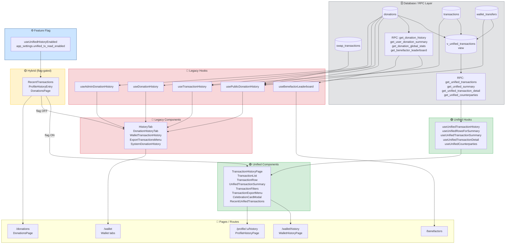

# Audit: Unified Transaction History — FUN Profile
**Ngày:** 2026-07-xx | **Auditor:** Read-only AI Audit | **Branch:** main

---

## 1. Coverage Matrix — Màn hình hiển thị lịch sử giao dịch

| # | Màn hình / Component | Route | File:Line | Datasource | Hook | Status |
|---|---|---|---|---|---|---|
| 1 | WalletHistoryPage | `/wallet/history` | `src/pages/WalletHistoryPage.tsx:48` | RPC `get_unified_transactions` | `useUnifiedTransactionHistory` | **Unified** |
| 2 | ProfileHistoryPage | `/profile/:username/history` | `src/pages/ProfileHistoryPage.tsx:55` | RPC `get_unified_transactions` | `useUnifiedTransactionHistory` | **Unified** |
| 3 | DonationsPage (flag ON) | `/donations` | `src/pages/Donations.tsx:52` | RPC `get_unified_transactions` | `useUnifiedTransactionHistory` | **Unified** |
| 4 | DonationsPage (flag OFF) | `/donations` | `src/pages/Donations.tsx:60` | `SystemDonationHistory` → `.from('donations')` | `useAdminDonationHistory` | **Legacy** |
| 5 | TransactionHistoryPage (shell) | embedded | `src/components/transactions/TransactionHistoryPage.tsx:1` | RPC `get_unified_transactions` | `useUnifiedTransactionHistory` | **Unified** |
| 6 | RecentTransactions (flag ON) | WalletCenter | `src/components/wallet/RecentTransactions.tsx:58` | RPC `get_unified_transactions` | via `RecentUnifiedTransactions` | **Unified** |
| 7 | RecentTransactions (flag OFF) | WalletCenter | `src/components/wallet/RecentTransactions.tsx:62` | `transactions` + `donations` tables | `useTransactionHistory` | **Legacy** |
| 8 | HistoryTab (wallet) | `/wallet` > tab Lịch sử | `src/components/wallet/tabs/HistoryTab.tsx:1` | `donations`+`wallet_transfers`+`swap_transactions` | `usePublicDonationHistory` | **Legacy** |
| 9 | DonationHistoryTab (wallet) | `/wallet` > tab Quà tặng | `src/components/wallet/DonationHistoryTab.tsx:1` | `.from('donations')` direct | `useDonationHistory` | **Legacy** |
| 10 | WalletTransactionHistory (popup) | Profile popup (flag OFF) | `src/components/profile/WalletTransactionHistory.tsx:1` | `donations`+`wallet_transfers`+`swap_transactions` | `usePublicDonationHistory` | **Legacy** |
| 11 | ProfileHistoryEntry (flag OFF) | ProfileHeader | `src/components/profile/ProfileHistoryEntry.tsx:35` | Same as #10 | `usePublicDonationHistory` | **Legacy** |
| 12 | DonationHistoryAdminTab | Admin panel | `src/components/admin/DonationHistoryAdminTab.tsx:1` | `.from('donations')` | `useAdminDonationHistory` | **Legacy** |
| 13 | BenefactorsPage | `/benefactors` | `src/pages/Benefactors.tsx:1` | RPC `get_benefactor_leaderboard` + `get_donation_global_stats` | `useBenefactorLeaderboard` | **Hybrid** |
| 14 | TreasuryPublicPage | `/treasury` | `src/pages/TreasuryPublicPage.tsx:1` | `useTreasuryPublicInflows` (separate table) | `useTreasuryPublicInflows` | **Legacy** |
| 15 | ClaimHistoryModal | Feed | `src/components/feed/ClaimHistoryModal.tsx:1` | `claim_rewards` table direct | `useQuery` direct | **Legacy** |

---

## 2. Hook Inventory

| Hook | File | Import Count | Status | Đọc Unified RPC? |
|---|---|---|---|---|
| `useUnifiedTransactionHistory` | `src/hooks/useUnifiedTransactionHistory.ts` | 4 | **Active** | ✅ `get_unified_transactions` |
| `useUnifiedTransactionSummary` | `src/hooks/useUnifiedTransactionHistory.ts` | 1 | **Active** | ✅ `get_unified_summary` |
| `useUnifiedTransactionDetail` | `src/hooks/useUnifiedTransactionHistory.ts` | 1 | **Active** | ✅ `get_unified_transaction_detail` |
| `useUnifiedRowsForSummary` | `src/hooks/useUnifiedTransactionHistory.ts` | 2 | **Active** | ✅ `get_unified_transactions` (large) |
| `useUnifiedCounterparties` | `src/hooks/useUnifiedTransactionHistory.ts` | 1 | **Active** | ✅ `get_unified_counterparties` |
| `useUnifiedHistoryEnabled` | `src/hooks/useUnifiedHistoryEnabled.ts` | 6 | **Active (feature-flag)** | ❌ reads `app_settings` |
| `usePublicDonationHistory` | `src/hooks/usePublicDonationHistory.ts` | 3 | **Legacy (in use)** | ❌ direct table reads |
| `useDonationHistory` | `src/hooks/useDonationHistory.ts` | 2 | **Legacy (in use)** | ❌ `.from('donations')` |
| `useAdminDonationHistory` | `src/hooks/useAdminDonationHistory.ts` | 2 | **Legacy (in use)** | ❌ `.from('donations')` |
| `useTransactionHistory` | `src/hooks/useTransactionHistory.ts` | 1 | **Legacy (compat-shim)** | ❌ transactions+donations |
| `useWalletHistory` | `src/hooks/useWalletHistory.ts` | 0 | **Dead** | ❌ Edge Function |
| `useBenefactorLeaderboard` | `src/hooks/useBenefactorLeaderboard.ts` | 1 | **Hybrid** | ⚠️ `get_benefactor_leaderboard` (legacy RPC) |
| `useShadowCompare` | `src/hooks/useShadowCompare.ts` | 0 | **Dev/Internal** | ✅ `get_unified_summary` |

---

## 3. Component Inventory (Legacy vs Unified)

| Component | File | Hook dùng | Dùng chung? | Status |
|---|---|---|---|---|
| `TransactionRow` | `src/components/transactions/TransactionRow.tsx` | `UnifiedTransactionRow` type | Unified only | **Unified** |
| `TransactionList` | `src/components/transactions/TransactionList.tsx` | via TransactionHistoryPage | Unified only | **Unified** |
| `TransactionFilters` | `src/components/transactions/TransactionFilters.tsx` | `useUnifiedCounterparties` | Unified only | **Unified** |
| `TransactionHistoryPage` | `src/components/transactions/TransactionHistoryPage.tsx` | `useUnifiedTransactionHistory` | Unified shell | **Unified** |
| `UnifiedTransactionSummary` | `src/components/transactions/UnifiedTransactionSummary.tsx` | `useUnifiedRowsForSummary` rows | Unified only | **Unified** |
| `RecentUnifiedTransactions` | `src/components/transactions/RecentUnifiedTransactions.tsx` | `useUnifiedTransactionHistory` | Unified only | **Unified** |
| `TransactionExportMenu` | `src/components/transactions/TransactionExportMenu.tsx` | RPC direct | Unified only | **Unified** |
| `CelebrationCardModal` | `src/components/transactions/CelebrationCardModal.tsx` | `useUnifiedTransactionDetail` | Unified only | **Unified** |
| `HistoryTab` | `src/components/wallet/tabs/HistoryTab.tsx` | `usePublicDonationHistory` | **Riêng - Legacy** | **Legacy** |
| `DonationHistoryTab` | `src/components/wallet/DonationHistoryTab.tsx` | `useDonationHistory` | **Riêng - Legacy** | **Legacy** |
| `WalletTransactionHistory` | `src/components/profile/WalletTransactionHistory.tsx` | `usePublicDonationHistory` | **Riêng - Legacy** | **Legacy** |
| `ExportTransactionsMenu` (wallet) | `src/components/wallet/ExportTransactionsMenu.tsx` | `mapDonationsToRows` | **Riêng - Legacy** | **Legacy** |
| `RecentTransactions` | `src/components/wallet/RecentTransactions.tsx` | feature-flag gated | **Hybrid** | **Hybrid** |
| `DonationReceivedCard` | `src/components/donations/DonationReceivedCard.tsx` | Props only | Dùng cả hai | **Hybrid** |
| `SystemDonationHistory` | `src/components/donations/SystemDonationHistory.tsx` | `useAdminDonationHistory` | **Riêng - Legacy** | **Legacy** |

---

## 4. Direct Datasource Reads

| Bảng | File | Dòng (approx) | Context |
|---|---|---|---|
| `donations` | `src/hooks/useDonationHistory.ts` | 49 | sent/received query |
| `donations` | `src/hooks/useDonationHistory.ts` | 75, 82 | stats (sent + received count) |
| `donations` | `src/hooks/useAdminDonationHistory.ts` | 60 | admin pagination |
| `donations` | `src/hooks/useAdminDonationHistory.ts` | 120–130 | stats: confirmed/pending/today/token loop |
| `donations` | `src/hooks/usePublicDonationHistory.ts` | ~130 | public profile history |
| `donations` | `src/hooks/useTransactionHistory.ts` | 47 | fallback merge |
| `transactions` | `src/hooks/useTransactionHistory.ts` | 39 | primary source |
| `wallet_transfers` | `src/hooks/usePublicDonationHistory.ts` | ~100 | transfer records |
| `swap_transactions` | `src/hooks/usePublicDonationHistory.ts` | ~85 | swap records |
| `swap_transactions` | `src/hooks/useGiftBreakdown.ts` | ~60 | gift breakdown |
| `v_unified_transactions` | *(none)* | — | Không đọc trực tiếp từ FE; chỉ qua RPC |

**RPC Calls tổng hợp:**

| RPC | File | Dòng | Loại |
|---|---|---|---|
| `get_unified_transactions` | `src/hooks/useUnifiedTransactionHistory.ts` | ~80, ~180 | Unified ✅ |
| `get_unified_summary` | `src/hooks/useUnifiedTransactionHistory.ts` | ~125 | Unified ✅ |
| `get_unified_transaction_detail` | `src/hooks/useUnifiedTransactionHistory.ts` | ~150 | Unified ✅ |
| `get_unified_counterparties` | `src/hooks/useUnifiedTransactionHistory.ts` | ~210 | Unified ✅ |
| `get_unified_transactions` | `src/components/transactions/TransactionExportMenu.tsx` | ~45 | Unified ✅ |
| `get_unified_summary` | `src/hooks/useShadowCompare.ts` | ~30 | Dev ✅ |
| `get_unified_summary` | `src/components/transactions/ShadowProbe.tsx` | ~55 | Dev ✅ |
| `get_user_donation_summary` | `src/hooks/usePublicDonationHistory.ts` | ~60 | **Legacy ⚠️** |
| `get_donation_history` | `src/hooks/useBenefactorLeaderboard.ts` | ~90 | **Legacy ⚠️** |
| `get_donation_global_stats` | `src/pages/Benefactors.tsx` | ~30 | **Legacy ⚠️** |
| `get_benefactor_leaderboard` | `src/hooks/useBenefactorLeaderboard.ts` | ~60 | Legacy (no unified equiv.) |
| `get_recipient_leaderboard` | `src/hooks/useBenefactorLeaderboard.ts` | ~75 | Legacy |

---

## 5. Summary Tính Riêng vs UnifiedTransactionSummary

**Vị trí duplicate:**
- `src/hooks/usePublicDonationHistory.ts:~60` — hàm `computeSummaryFromDonations()` tự tính `received`/`sent` breakdowns theo token. **Trùng hoàn toàn** với `UnifiedTransactionSummary.aggregate()` (`src/components/transactions/UnifiedTransactionSummary.tsx:48`).
- `src/hooks/useDonationHistory.ts:75–90` — `useDonationStats` tự loop `sentData`/`receivedData` để group by token.
- `src/components/wallet/tabs/HistoryTab.tsx` — `SummaryTable` component tự render summary từ `DonationSummary` object.

**Đề xuất:** Xoá 3 implementations trên, dùng `useUnifiedRowsForSummary` + `UnifiedTransactionSummary`.

---

## 6. Format Amount Duplicate

| File | Hàm | Snippet |
|---|---|---|
| `src/components/wallet/tabs/HistoryTab.tsx:~80` | `formatAmount(num, lang)` | `if(num<0.0001) return num.toFixed(8)...toLocaleString(locale, {maximumFractionDigits:4})` |
| `src/components/profile/WalletTransactionHistory.tsx:~60` | `formatAmount(num)` | `if(num<0.0001) return num.toFixed(8)...toLocaleString('vi-VN',{maximumFractionDigits:4})` |
| `src/components/feed/GiftHistoryCalendar.tsx:~15` | `formatAmount(amount, symbol)` | local inline |
| `src/lib/formatTokenAmount.ts` | `formatTokenAmount(num, symbol)` | **SSOT — canonical** |

`TransactionRow` và `UnifiedTransactionSummary` đã dùng `formatTokenAmount`. Ba hàm trên cần xoá.

---

## 7. Direction Logic Duplicate

| File | Dòng | Snippet |
|---|---|---|
| `src/utils/export/mapRows.ts:~45` | `if(d.recipient_id===currentUserId) direction='in'; else if(d.sender_id===currentUserId) direction='out'` |
| `src/hooks/usePublicDonationHistory.ts:~160` | `const isSent = d.sender_id === userId;` rồi split sent/received |
| `src/hooks/useTransactionHistory.ts` | `const isSender = d.sender_id === userId;` (void'd) |

Unified RPC trả về `direction` field (computed DB-side). Tất cả FE calc trên là redundant.

---

## 8. External Wallet Detection Duplicate

| File | Dòng | Pattern |
|---|---|---|
| `src/hooks/useGiftHistory.ts:~15` | `.not('is_external','is',true)` — filter client-side |
| `src/hooks/useGiftBreakdown.ts:~60` | `.not('is_external','is',true)` |
| `src/utils/export/mapRows.ts` | `d.is_external ? 'Ví ngoài' : 'Ẩn danh'` |
| `src/components/transactions/TransactionRow.tsx:~40` | `if(row.is_external && !row.counterparty_user_id)` — unified SSOT |

---

## 9. Status Label Duplicate

| File | Pattern |
|---|---|
| `src/components/wallet/tabs/HistoryTab.tsx:~55` | `function StatusBadge` inline |
| `src/components/wallet/RecentTransactions.tsx:~15` | `function StatusBadge` inline |
| `src/utils/exportDonations.ts:~40` | `{pending:'Đang xử lý',confirmed:'Thành công'...}` |
| `src/utils/export/mapRows.ts:~10` | `STATUS_VI` map |
| `src/utils/export/exportPdf.ts:~30` | `if(x==='confirmed'||x==='completed') return 'Thành công'` |
| `src/components/transactions/TransactionRow.tsx:~55` | `statusBadge()` — **SSOT** |

---

## 10. Mapper Duplicate

| File | Hàm | Notes |
|---|---|---|
| `src/utils/export/mapRows.ts` | `mapDonationsToRows()` | Dùng DonationRecord shape cũ |
| `src/components/transactions/TransactionExportMenu.tsx:~50` | `rowsFromUnified()` | Dùng UnifiedTransactionRow — **SSOT** |

`mapDonationsToRows` được dùng tại: `HistoryTab.tsx`, `WalletTransactionHistory.tsx`, `ClaimHistoryModal.tsx`.

---

## 11. Export Duplicate

| File | Tool | Notes |
|---|---|---|
| `src/utils/exportDonations.ts` | `exportDonationsToCSV()` | Legacy CSV từ DonationRecord |
| `src/components/wallet/ExportTransactionsMenu.tsx` | `ExportTransactionsMenu` | Dùng `mapDonationsToRows` — Legacy |
| `src/components/transactions/TransactionExportMenu.tsx` | `TransactionExportMenu` | RPC unified trực tiếp — **Unified SSOT** |

`ExportTransactionsMenu` (wallet) được import tại `HistoryTab.tsx`, `WalletTransactionHistory.tsx`, `ClaimHistoryModal.tsx`.

---

## 12. Search/Filter Duplicate

`usePublicDonationHistory` tự implement filter: `currentFilter === 'sent' | 'received' | 'swap' | 'transfer'` client-side sau khi fetch. `TransactionFilters` unified đẩy filter xuống RPC. Không có FTS index ở legacy.

---

## 13. Transaction Row Duplicate

| Component | File | Dùng type |
|---|---|---|
| `TransactionRow` | `src/components/transactions/TransactionRow.tsx` | `UnifiedTransactionRow` — SSOT |
| Row trong `HistoryTab` | inline JSX trong `HistoryTab.tsx` | `DonationRecord` |
| Row trong `WalletTransactionHistory` | inline JSX | `DonationRecord` |
| Row trong `DonationHistoryAdminTab` | inline JSX | `DonationRecord` |

---

## 14. Summary Card Duplicate

`UnifiedTransactionSummary` là SSOT. Legacy: `SummaryTable` trong `HistoryTab.tsx` (~line 140) và `WalletTransactionHistory.tsx` (~line 200) đều tự render bảng Token | Nhận | Gửi riêng.

---

## 15. Celebration Card Duplicate

| Component | File | Nguồn data |
|---|---|---|
| `DonationReceivedCard` | `src/components/donations/DonationReceivedCard.tsx` | `DonationReceivedData` (legacy shape) |
| `CelebrationCardModal` | `src/components/transactions/CelebrationCardModal.tsx` | `useUnifiedTransactionDetail` (unified) |
| `GiftCelebrationCard / GifCelebrationGroup` | `src/components/feed/GiftCelebrationCard.tsx` | Feed post data |
| `DonationSuccessCard` | `src/components/donations/DonationSuccessCard.tsx` | Post-send confirmation |

`DonationReceivedCard` vẫn được render trong `HistoryTab` và `WalletTransactionHistory` (flag OFF). `CelebrationCardModal` là unified path.

---

## 16. Notification Liên Quan Giao Dịch

Không tìm thấy `notificationService` hay `useNotifications` kết nối trực tiếp vào unified pipeline. `DonationReceivedNotification.tsx` đọc `.from('donations')` và `.from('notifications')` qua realtime subscription — **nằm ngoài unified pipeline**, chưa được migrate.

---

## 17. Transaction Detail Drawer/Modal

| Component | File | Datasource |
|---|---|---|
| `CelebrationCardModal` | `src/components/transactions/CelebrationCardModal.tsx` | `useUnifiedTransactionDetail` → RPC `get_unified_transaction_detail` |
| Inline expand row trong `HistoryTab` | trong `HistoryTab.tsx` | expand state, no drawer |
| Inline detail trong `WalletTransactionHistory` | trong `WalletTransactionHistory.tsx` | expand state, `Collapsible` |

---

## 18. Tóm tắt Duplication

| Hạng mục | Số nơi trùng | SSOT hiện tại |
|---|---|---|
| Format amount | 3 hàm duplicate | `formatTokenAmount` |
| Direction calc | 3 nơi | RPC field `direction` |
| Summary tính | 3 implementations | `UnifiedTransactionSummary` |
| Status label | 5 nơi | `TransactionRow.statusBadge()` |
| Export | 2 legacy + 1 unified | `TransactionExportMenu` |
| Mapper | 2 | `rowsFromUnified()` |
| Celebration card | 2 paths | `CelebrationCardModal` |
| Transaction row | 3 inline + 1 component | `TransactionRow` |

---

## 19. Dependency Graph



---

## 20. M6 Cleanup Plan Chi Tiết

### Phase 1 — Safe Removal, Non-Breaking (Tuần 1)
**Mục tiêu:** Bật feature flag toàn cục, thêm deprecation warning.

| Hành động | File | Effort |
|---|---|---|
| Set `unified_tx_read_enabled = true` trong `app_settings` | DB/Admin | 0.5h |
| Thêm `console.warn('[DEPRECATED]')` vào `useDonationHistory` | `src/hooks/useDonationHistory.ts` | 0.5h |
| Thêm `console.warn('[DEPRECATED]')` vào `usePublicDonationHistory` | `src/hooks/usePublicDonationHistory.ts` | 0.5h |
| Thêm `console.warn('[DEPRECATED]')` vào `useTransactionHistory` | `src/hooks/useTransactionHistory.ts` | 0.5h |
| Monitor ShadowProbe: đảm bảo diff count = 0 | Datadog/Logs | 2h |

**Acceptance:** ShadowProbe không báo diff > 0 sau 48h. Rollback: set flag `= false`.

---

### Phase 2 — Migrate Surfaces (Tuần 2–3)
**Thứ tự ưu tiên (bottom-up):**

1. `src/components/wallet/tabs/HistoryTab.tsx` → Replace `usePublicDonationHistory` bằng `useUnifiedTransactionHistory`, replace `ExportTransactionsMenu` bằng `TransactionExportMenu`.
2. `src/components/wallet/DonationHistoryTab.tsx` → Redirect sang `/wallet/history?type=donation`.
3. `src/components/profile/WalletTransactionHistory.tsx` → Xoá; `ProfileHistoryEntry` flag OFF branch redirect tới unified page.
4. `src/pages/Donations.tsx` → Xoá legacy branch (`SystemDonationHistory`).
5. `src/components/wallet/RecentTransactions.tsx` → Xoá flag check, luôn render `RecentUnifiedTransactions`.

**Acceptance:** 0 import còn lại tới legacy hooks (`useDonationHistory`, `usePublicDonationHistory`, `useTransactionHistory`). Effort: ~3 ngày.

---

### Phase 3 — Delete Legacy (Tuần 4)

**Files xoá:**

| File | Ghi chú |
|---|---|
| `src/hooks/useDonationHistory.ts` | Xoá sau khi 0 import |
| `src/hooks/usePublicDonationHistory.ts` | Xoá |
| `src/hooks/useTransactionHistory.ts` | Xoá |
| `src/hooks/useWalletHistory.ts` | Dead hook — xoá ngay |
| `src/utils/exportDonations.ts` | Replace bằng unified export |
| `src/components/wallet/ExportTransactionsMenu.tsx` | Xoá |
| `src/components/donations/SystemDonationHistory.tsx` | Xoá |
| `src/components/profile/WalletTransactionHistory.tsx` | Xoá |
| `src/components/wallet/DonationHistoryTab.tsx` | Xoá |
| `src/utils/export/mapRows.ts::mapDonationsToRows` | Xoá hàm này (giữ file nếu còn `mapClaimsToRows`) |

**Draft SQL (KHÔNG chạy ngay — cần kiểm tra dependencies):**
```sql
-- Phase 3 DB cleanup draft
-- DROP FUNCTION IF EXISTS get_donation_history(p_user_id uuid, p_type text, p_limit int, p_offset int);
-- DROP FUNCTION IF EXISTS get_user_donation_summary(p_user_id uuid);
-- DROP FUNCTION IF EXISTS get_donation_global_stats(p_time_range text);
-- DROP FUNCTION IF EXISTS get_benefactor_leaderboard(...); -- kiểm tra /benefactors trước
```

**Acceptance:** `rg -rn "useDonationHistory|usePublicDonationHistory|useTransactionHistory"` trả về 0 kết quả. **Rollback:** git revert Phase 3 commit. Effort: 1 ngày.

---

## Technical Debt Report

| Priority | ID | Mô tả | Evidence | Tác động |
|---|---|---|---|---|
| **P0** | TD-01 | Feature flag `unified_tx_read_enabled` đang OFF — hầu hết surfaces vẫn chạy Legacy, gây nguy cơ data inconsistency giữa 2 pipeline | `src/hooks/useUnifiedHistoryEnabled.ts:25` default=false | Mất dữ liệu / hiển thị sai nếu view/RPC update mà legacy cache cũ |
| **P0** | TD-02 | `useAdminDonationHistory` loop toàn bộ donations theo trang 1000 để tính `totalByToken` — O(n) không có giới hạn, gây timeout với dataset lớn | `src/hooks/useAdminDonationHistory.ts:130–150` | Performance: admin panel treo khi >50k donations |
| **P1** | TD-03 | `usePublicDonationHistory` fetch 3 bảng song song client-side mà không có pagination server-side thực sự — `PAGE_SIZE=200` nhưng merge rồi client-sort | `src/hooks/usePublicDonationHistory.ts:80–170` | N+1 queries, memory spike trên mobile |
| **P1** | TD-04 | `useWalletHistory` (dead hook) vẫn tồn tại, gây confusion; gọi Edge Function `fetch-wallet-history` không có trong unified pipeline | `src/hooks/useWalletHistory.ts:1` import_count=0 | Tech debt / confusion |
| **P1** | TD-05 | 5 implementations `StatusBadge/statusLabel` riêng biệt, không nhất quán: `HistoryTab` dùng i18n key `txSuccess`; `TransactionRow` dùng string hardcode tiếng Việt `✅ Thành công` | multiple files | UX inconsistency + i18n bug |
| **P1** | TD-06 | `ShadowProbe` đọc count từ 3 bảng nguồn rồi so sánh với `get_unified_summary` — nếu view chưa index đủ, query này gây full scan | `src/components/transactions/ShadowProbe.tsx:52–70` | Load bất ngờ trên DB production |
| **P2** | TD-07 | `DonationReceivedNotification.tsx` subscribe realtime `.from('donations')` ngoài unified pipeline — nếu migrate bảng source thì notification break | `src/components/donations/DonationReceivedNotification.tsx` | Notification mất khi deprecate bảng donations |
| **P2** | TD-08 | `useTransactionHistory` có comment hardcode "sự cố 12/06/2026" filter BTC EVM address — business logic tạm thời chưa được clean | `src/hooks/useTransactionHistory.ts:52–58` | Ongoing data quality risk |
| **P2** | TD-09 | `useUnifiedRowsForSummary` fetch tới 5000 rows client-side để tính summary — nếu user có >5000 tx thì summary sai | `src/hooks/useUnifiedTransactionHistory.ts:~180` `limit=5000` | Data truncation / wrong summary |
| **P2** | TD-10 | `ClaimHistoryModal` dùng `useQuery` direct `.from('claim_rewards')` + export riêng `mapClaimsToRows` — nằm hoàn toàn ngoài unified pipeline, không có plan migrate | `src/components/feed/ClaimHistoryModal.tsx:1` | Orphan feature |

---

*Report generated by read-only AI audit. Tất cả số liệu có evidence file:line. Không có file nguồn nào bị sửa đổi.*
