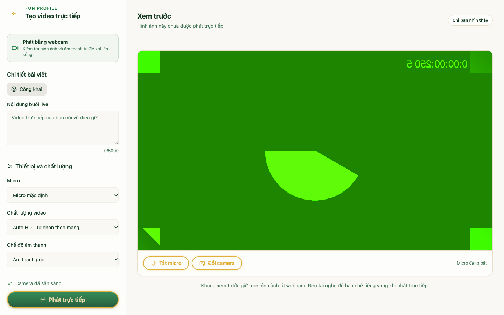
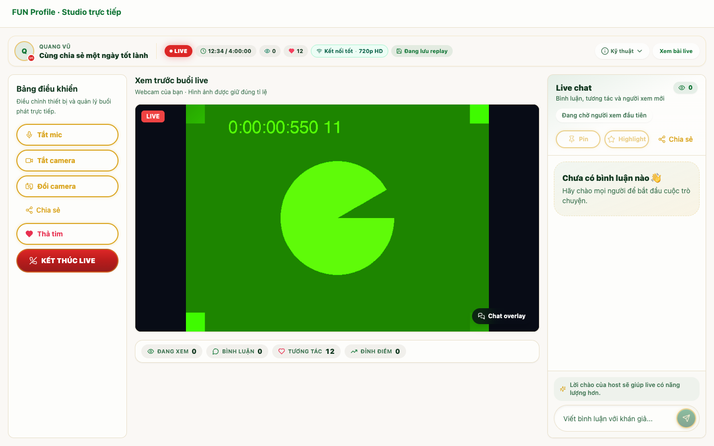

# Webcam live desktop — 26/11/2026

## Vấn đề và cách bố trí

`/live/setup` phủ webcam toàn màn hình và điều khiển như mobile trên cả desktop. Host desktop có chat riêng nhưng chỉ tách cột từ 1280px, preview ép chiều cao tối thiểu và nhiều điều khiển/metrics chồng lên hình.

Từ 1024px, setup có cột chi tiết/cấu hình 320–360px, footer nút bắt đầu luôn thấy, preview ngang 16:9 với object-contain. Micro, chất lượng và chế độ âm thanh dùng controller hiện có; đổi camera dùng thao tác hiện có. Công khai là trạng thái thực hiện tại, không tạo dropdown quyền riêng tư giả.

Host desktop: trạng thái trên cùng; điều khiển bên trái, video/số liệu giữa, bình luận bên phải ngay từ 1024px. Chat và các vùng điều khiển cuộn riêng khi cần. Preview bỏ min-height420px, không ép phóng/cắt webcam dọc; chat overlay tùy chọn mặc định tắt. Bỏ hai nút Analytics/Feed post vốn disabled, không thay các tính năng đã hoạt động.

Dưới 1024px dùng UI mobile hiện có. Setup tái gắn cùng stream vào phần tử video khi đổi bố cục, không khởi động lại camera chỉ vì resize. Mic đã tắt tiếp tục tắt khi chọn chất lượng/micro mới. Hook state chat được gọi trước nhánh responsive để không lỗi thứ tự hooks khi resize.

Thêm semantic token media cho nền tối preview; giữ nhận diện FUN Profile. Không đổi route, backend, quyền, pipeline RTC/RTMP, ghi replay, quota hoặc lưu trữ.

## Kiểm chứng

- 3 test controller: chờ camera trước start + payload, giữ mute khi đổi chất lượng + stream khi resize, camera bị từ chối/start disabled/retry/Back.
- Chrome thật với thiết bị media giả và backend local, chặn request ngoài localhost; không phát live production.
- Setup: desktop 1024×768, 1920×1080 không overflow, preview16:9, nút bắt đầu trong viewport; đã xem ảnh1440×900 và mobile390×844.
- Host:1024/1440/1920 không overflow, chat trong viewport; callback mic/chat/end, payload mô tả/chất lượng, resize mobile→desktop không lỗi hooks. Kết thúc chỉ gọi callback xác nhận, không gọi API live thật.
- Số liệu: `browser-proof.json`. 717 test offline đạt,53 skip,107 file; tsgo đạt. Build kiểm trước commit. Self-review tác giả, không review độc lập.

## Ảnh kiểm tra

Camera xanh là thiết bị giả của Chrome, không phải webcam người dùng.

## Phát hành / rollback

Qua PR và Preview đúng commit trước merge; Cloudflare Pages tự triển khai từ main. Kiểm thử layout không thay thế kiểm chứng chất lượng đường truyền RTC thật. Khôi phục giao diện bằng PR revert commit tính năng; không có migration hoặc secrets cần khôi phục.
