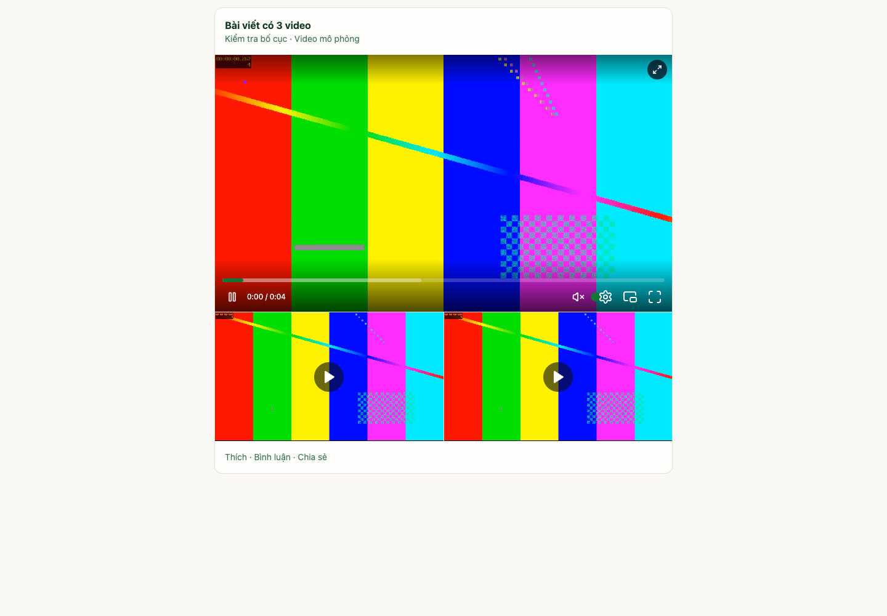

# Bố cục ba video — 27/11/2026

## Bài thực tế và nguyên nhân

Public SELECT xác nhận bài Father trong ảnh có đúng3 media, đều là video, thứ tự giữ nguyên. Receipt ID/ngày/số lượng: post-proof.json. Không thay đổi bài hoặc dữ liệu video.

Lưới cũ chia ô vuông và cho ô thứ hai chiếm2hàng, trong khi player ngang tự giữ16:9; phần ô còn lại thành khoảng trắng. Nhóm đúng3video nay có một video toàn chiều ngang phía trên, hai preview bằng nhau phía dưới; các tile tự giữ16:9, player lấp đúng ô, nội dung object-contain.

## Thay đổi và phạm vi

- Một video chính có đầy đủ điều khiển; hai preview dưới không autoplay, không dồn controls nhỏ, có nút phát mở gallery.
- Mở gallery tạm dừng video nền; từng video mở đúng thứ tự và giữ nguyên tệp/tỉ lệ để xem đầy đủ. Nút mở và trước/sau/đóng có nhãn truy cập bàn phím.
- Chỉ đổi bố cục khi đúng3media đều là video. Bài1/2/4+media và nhóm ảnh/mixed giữ nhánh cũ. Các prop controls/previewOnly mới có mặc định giữ player hiện hành.
- Không thay pipeline tối ưu/lưu trữ, URL media, metadata xử lý hoặc quyền xem/tải. Các nhãn xử lý video hiện có không thuộc thay đổi này.

## Kiểm chứng

- Chrome với MediaGrid/FeedVideoPlayer/gallery thật, video mô phỏng local; chặn request ngoài localhost.
- 390/768/1440px, cả nhóm ngang và nhóm có video dọc: khe giữa hai hàng1px, hai ô dưới cùng hàng/rộng bằng nhau, phần trống cuối lưới0px, không overflow; player cao đúng bằng ô.
- Hai preview nhỏ ở trạng thái paused. Mở/phát từng video0/1/2 đúng src, object-contain, video nền paused; bàn phím Enter và trước/sau giữ đúng thứ tự.
- 727 test offline đạt/53 skip/109 file; tsgo đạt. Build kiểm trước commit. Không thêm test chỉ soi class CSS; đo layout và thao tác thực trên browser. Self-review tác giả, không review độc lập.
- Ảnh dưới là video kiểm thử mô phỏng, không phải nội dung thay thế bài Father.

## Phát hành và rollback

PR→Preview đúng commit→merge; Cloudflare Pages tự triển khai từ main. Khôi phục bằng PR revert commit giao diện. Không có migration/secrets/dữ liệu cần khôi phục.
